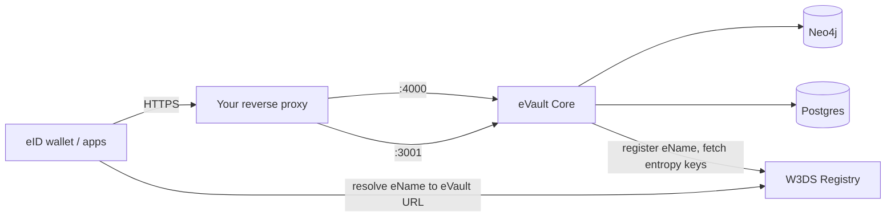

# Self-hosting an eVault

This guide runs a standalone eVault on your own server and connects it to an existing W3DS Registry, by default the production one at `https://registry.w3ds.metastate.foundation`. It is for operators deploying outside `localhost`. To run the whole stack on a laptop, use the [Local Dev Quick Start](/docs/Post%20Platform%20Guide/local-dev-quick-start) instead.

At the moment the eVault is the only component that is ready to self-host. The Registry, PKI and eID wallet keep running on the shared W3DS infrastructure, and your eVault plugs into them.

## What you run

| Component | Role | Exposed |
|-----------|------|---------|
| **eVault Core** | Stores the data. Port 4000 serves GraphQL, `/whois` and the API docs. Port 3001 is the provisioner, which creates new eVaults and serves `/health`, `/ready` and the provisioner's signing key | Both ports, through your HTTPS reverse proxy |
| **Neo4j 4.4** | Graph database for eVault contents | Internal only |
| **Postgres** | Provisioner state: verifications, notifications, rate-limit rules | Internal only |

One eVault Core instance is multi-tenant: it hosts any number of eVaults (eNames), and keeps them apart using the `X-ENAME` header on every request.



How provisioning works: the wallet fetches a signed entropy token from the Registry and sends it to **your** provisioner. Your provisioner derives the eName and records `eName → PUBLIC_EVAULT_SERVER_URI` in the Registry. From then on, anyone who resolves that eName through the Registry is sent to your eVault.

## Prerequisites

- A Linux server with **Docker** and **Docker Compose v2**
- **Two public HTTPS hostnames**, for example `evault.example.org` (port 4000) and `provisioner.example.org` (port 3001)
- **A publicly trusted TLS certificate** for both hostnames (Let's Encrypt is fine). See [Why not a self-signed certificate?](#why-not-a-self-signed-certificate)
- **Outbound HTTPS** from the server to the Registry
- **A `REGISTRY_SHARED_SECRET`** from the Registry operator. Your provisioner needs it to register new eNames. To join the shared W3DS Registry, ask the W3DS team.

## 1. Get the code

```bash
git clone https://github.com/MetaState-Prototype-Project/prototype.git
cd prototype
```

No Node.js install is needed on the server, because the eVault image is built inside Docker.

## 2. Configure

```bash
cp docker/evault/.env.example docker/evault/.env
```

Edit `docker/evault/.env`. The values you must set are:

| Variable | What to put there |
|----------|-------------------|
| `POSTGRES_PASSWORD`, `NEO4J_PASSWORD` | Strong random passwords. These databases are only reachable inside the compose network. |
| `PUBLIC_EVAULT_SERVER_URI` | Public HTTPS URL of port 4000, e.g. `https://evault.example.org`. **This is the URL the Registry gives out for every eName you provision**, so it must be reachable from the internet. |
| `PUBLIC_PROVISIONER_URL` | Public HTTPS URL of port 3001, e.g. `https://provisioner.example.org`. |
| `PUBLIC_REGISTRY_URL` | The Registry to join. Production: `https://registry.w3ds.metastate.foundation`. Staging: `https://registry.staging.metastate.foundation`. |
| `REGISTRY_SHARED_SECRET` | The secret the Registry operator gave you. |
| `PROVISIONER_SIGNING_SEED` | Generate with `openssl rand -hex 32`. Keep it stable: it is the key that signs binding documents. |
| `DEMO_CODE_W3DS` | Optional. See [Provisioning without ID verification](#provisioning-without-id-verification). |
| `EVAULT_TRUST_PROXY` | The address(es) your reverse proxy connects from, so rate limiting sees real client IPs. The default `172.16.0.0/12` covers Docker bridge networks. |

`docker/evault/.env.example` explains each option, including the optional ones.

:::note
This stack has its own `.env` under `docker/evault/` and does not read the repo-root `.env` used for local development.
:::

## 3. Start

```bash
docker compose -f docker/evault/docker-compose.yml up -d --build
```

The first build takes a few minutes. Compose then:

1. starts Postgres and Neo4j and waits until both are healthy,
2. runs the Postgres migrations once (`evault-migrate`, which exits when it is done),
3. starts `evault` with `restart: unless-stopped`, so it survives crashes and reboots.

Ports `3001` and `4000` are bound to `127.0.0.1` only. Nothing is public until your reverse proxy forwards to them.

Day-to-day commands:

```bash
docker compose -f docker/evault/docker-compose.yml ps
docker compose -f docker/evault/docker-compose.yml logs -f evault
docker compose -f docker/evault/docker-compose.yml down        # stop, keep data
```

To upgrade, run `git pull`, then the same `up -d --build` command. Migrations run again automatically. The data lives in the `evault_postgres_data` and `evault_neo4j_data` volumes, so back those up.

## 4. Put HTTPS in front

Any reverse proxy works. Here is an nginx example for two hostnames, using certificates from Let's Encrypt (`certbot --nginx`):

```nginx
# /etc/nginx/conf.d/evault.conf
server {
    listen 443 ssl;
    server_name evault.example.org;
    ssl_certificate     /etc/letsencrypt/live/evault.example.org/fullchain.pem;
    ssl_certificate_key /etc/letsencrypt/live/evault.example.org/privkey.pem;

    # Files are uploaded base64-encoded inside GraphQL requests
    client_max_body_size 350m;

    location / {
        proxy_pass http://127.0.0.1:4000;
        proxy_http_version 1.1;
        proxy_set_header Host $host;
        proxy_set_header X-Forwarded-For $proxy_add_x_forwarded_for;
        proxy_set_header X-Forwarded-Proto $scheme;
        proxy_read_timeout 300s;
    }
}

server {
    listen 443 ssl;
    server_name provisioner.example.org;
    ssl_certificate     /etc/letsencrypt/live/provisioner.example.org/fullchain.pem;
    ssl_certificate_key /etc/letsencrypt/live/provisioner.example.org/privkey.pem;

    location / {
        proxy_pass http://127.0.0.1:3001;
        proxy_http_version 1.1;
        proxy_set_header Host $host;
        proxy_set_header X-Forwarded-For $proxy_add_x_forwarded_for;
        proxy_set_header X-Forwarded-Proto $scheme;
        # Verification status stream (server-sent events)
        proxy_buffering off;
        proxy_read_timeout 1h;
    }
}
```

If nginx runs on the host, set `EVAULT_TRUST_PROXY=127.0.0.1` instead, or to the Docker gateway address the connections come from.

### Why not a self-signed certificate?

The eVault URL is published through the Registry and used by clients you don't control: the eID wallet on users' phones, W3DS platforms, and other eVaults. None of them trust your private CA, so with a self-signed certificate their requests fail at the TLS handshake. Use a publicly trusted certificate on anything registered in a shared Registry.

A self-signed or internal-CA certificate is only workable for a closed test where every client is yours. In that case, make each Node.js client trust it with `NODE_EXTRA_CA_CERTS=/path/to/ca.pem`, and expect the mobile wallet not to work.

## 5. Validate

Run these from any machine. Replace the hostnames with your own.

```bash
EVAULT=https://evault.example.org
PROVISIONER=https://provisioner.example.org
REGISTRY=https://registry.w3ds.metastate.foundation
```

**Process and database health**

```bash
curl -s $PROVISIONER/health      # {"status":"ok"}
curl -s $PROVISIONER/ready       # neo4j: "ok". Reports "not-ready" while AWARENESS_SERVICE_URL is unset; that is expected.
curl -s $PROVISIONER/.well-known/jwks.json   # one Ed25519 key, from PROVISIONER_SIGNING_SEED
```

**End-to-end: provision a test eVault and resolve it through the Registry**

```bash
# 1. Signed entropy from the Registry
ENTROPY=$(curl -s $REGISTRY/entropy | jq -r .token)

# 2. Provision on YOUR eVault (the verificationId is DEMO_CODE_W3DS; this is its default)
curl -s -X POST $PROVISIONER/provision \
  -H 'Content-Type: application/json' \
  -d "{\"registryEntropy\":\"$ENTROPY\",\"namespace\":\"$(uuidgen)\",\"verificationId\":\"d66b7138-538a-465f-a6ce-f6985854c3f4\"}"
# -> {"success":true,"w3id":"@…","uri":"https://evault.example.org"}

ENAME='@…'   # the w3id from the response

# 3. The Registry now points that eName at your eVault
curl -s "$REGISTRY/resolve?w3id=$ENAME"
# -> {"kind":"evault","ename":"@…","uri":"https://evault.example.org",…}

# 4. Your eVault answers for it
curl -s $EVAULT/whois -H "X-ENAME: $ENAME"
# -> {"w3id":"@…", …}
```

If all four steps succeed, your eVault is provisioning, registered, and reachable through the shared infrastructure. Each failure points at a specific cause:

| Symptom | Likely cause |
|---------|--------------|
| `/provision` `error` contains `JWT verification failed` | `PUBLIC_REGISTRY_URL` is wrong, or the server can't reach it |
| `/provision` `error` is `{"error":"Invalid shared secret"}` | `REGISTRY_SHARED_SECRET` doesn't match the Registry's |
| `/provision` returns `verification doesn't exist` | `verificationId` isn't your `DEMO_CODE_W3DS` |
| `/resolve` works but `/whois` fails from outside | Proxy or DNS for `PUBLIC_EVAULT_SERVER_URI`, or a certificate the client doesn't trust |

You can also go through the same flow interactively: open the [Dev Sandbox](/docs/Post%20Platform%20Guide/dev-sandbox), set its **Registry URL** and **Provisioner URL** fields to the Registry and your provisioner, and click **Provision new eVault**. The interactive API reference is at `$EVAULT/docs`.

## Provisioning without ID verification

`/provision` normally requires a `verificationId` from an approved ID check (Didit). One value is accepted without a check: `DEMO_CODE_W3DS`, which defaults to a publicly known UUID that the Dev Sandbox also uses. That suits a closed test. Before you expose the provisioner more widely, set `DEMO_CODE_W3DS` to your own random UUID (`uuidgen`), or restrict who can reach `PUBLIC_PROVISIONER_URL` at the proxy. Otherwise anyone can create eVaults on your server.

## Optional: run the Dev Sandbox on your server

The Dev Sandbox is a SvelteKit app. On a server, run the **production build** rather than `pnpm dev`. Vite's dev server only answers requests for `localhost` unless you add hosts to `allowedHosts`, and it isn't meant to be long-running.

```bash
docker build -f docker/Dockerfile.dev-sandbox -t dev-sandbox .
docker run -d --restart unless-stopped -p 127.0.0.1:8080:3000 \
  -e PUBLIC_REGISTRY_URL=https://registry.w3ds.metastate.foundation \
  -e PUBLIC_PROVISIONER_URL=https://provisioner.example.org \
  dev-sandbox
```

Then proxy a hostname to `127.0.0.1:8080`, as in [step 4](#4-put-https-in-front). The Registry and provisioner URLs can also be changed in the sandbox UI.

## What stays shared for now

- **Registry**: your eNames are recorded in the shared W3DS Registry. It stores only the `eName → eVault URL` lookup and key certificates, never eVault contents. Running a separate Registry alongside it needs the next Registry version.
- **PKI and eID wallet**: users keep using the W3DS eID wallet and certificate authority. The public wallet provisions on the W3DS provisioner by default. You can provision eVaults on your server with the Dev Sandbox, the wallet SDK, or a wallet build that points `PUBLIC_PROVISIONER_URL` at your provisioner.
